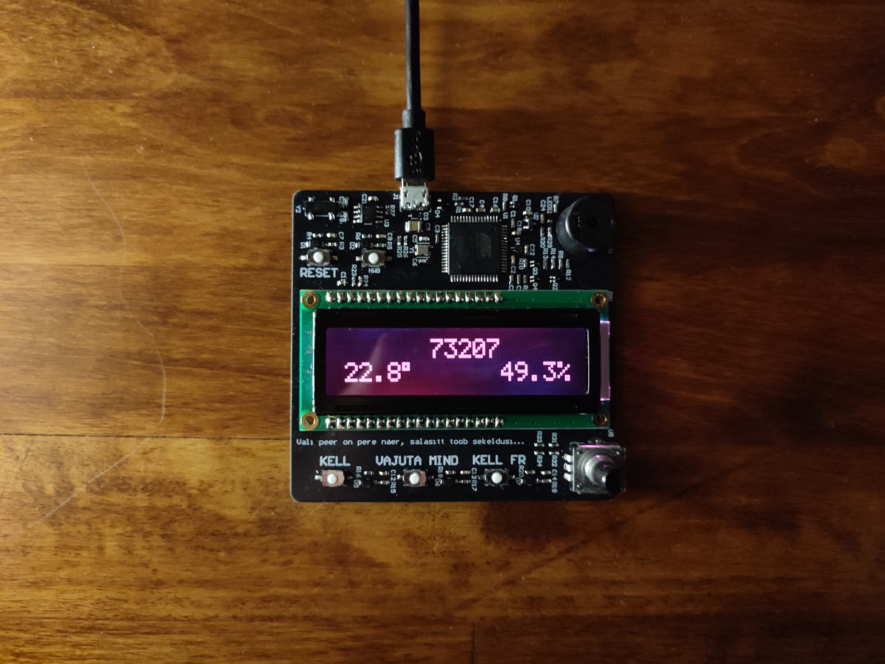
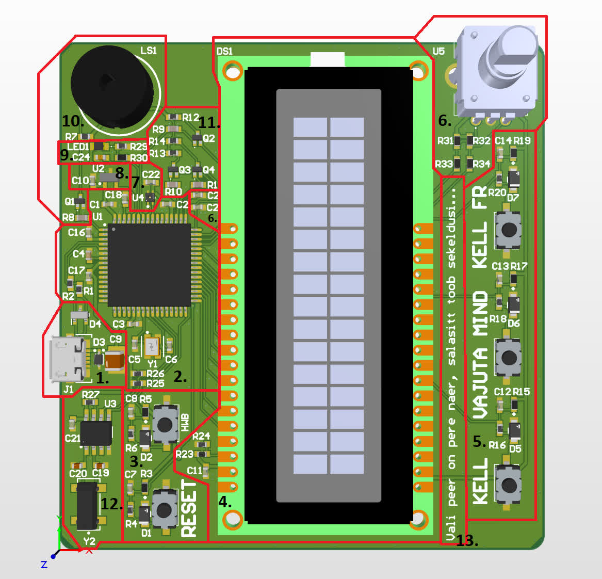
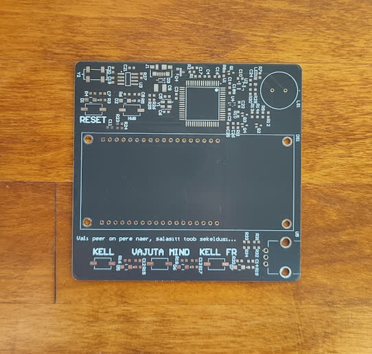
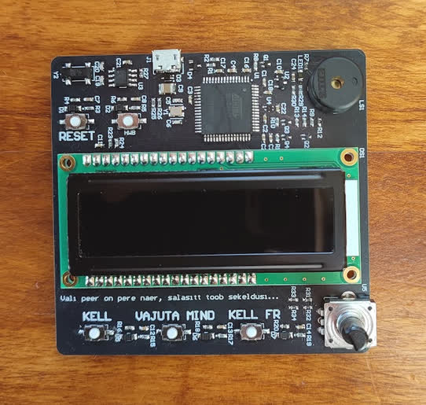
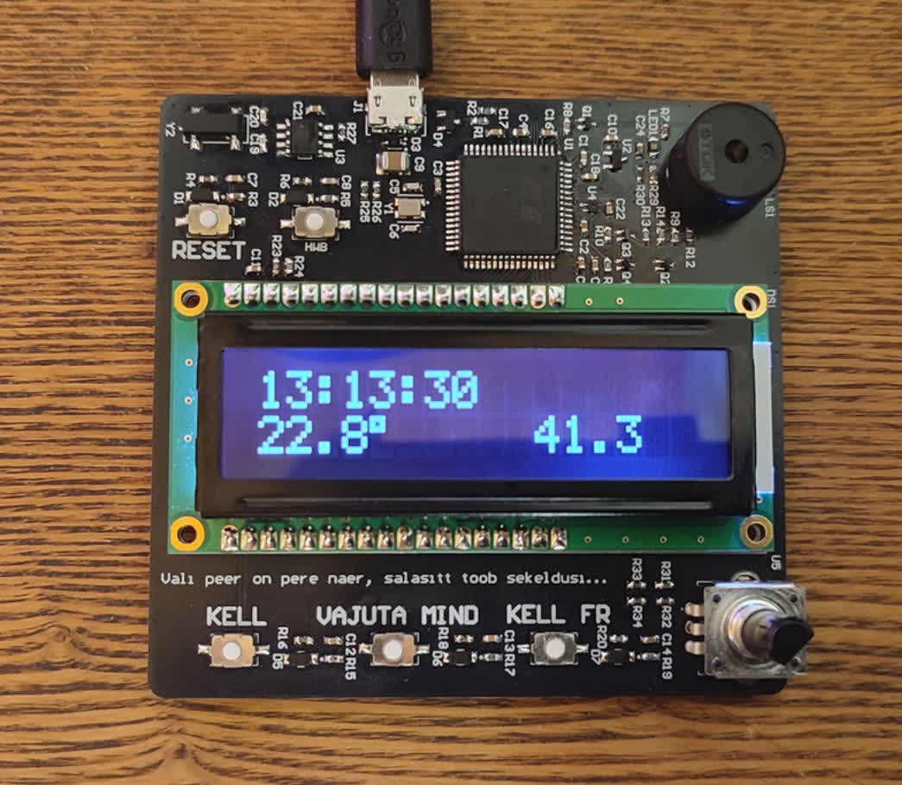
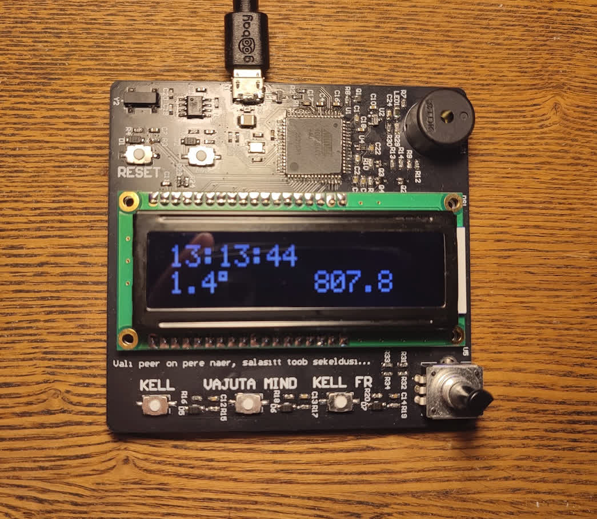
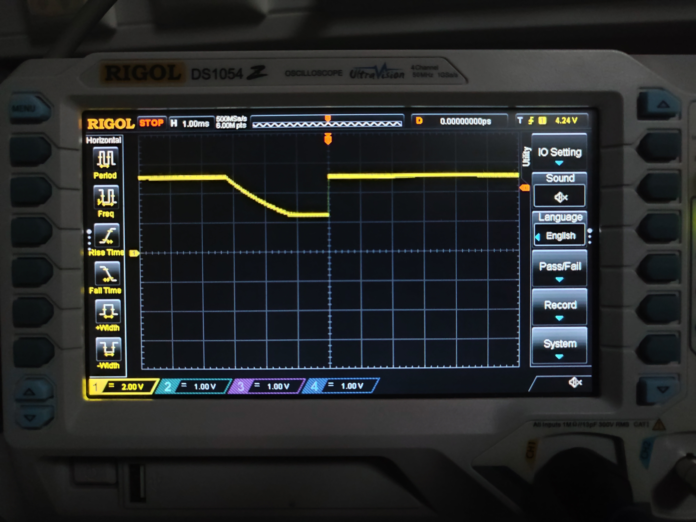

# Dumb-Clock

> ### State of the project: completed

This device displays time, temperature and relative humidity.
It displays time in seconds, and to see the time in the normal format of HH:MM:SS, the user has to successfuly complete a memory game.
To interact with the board, there is an LCD, 3 user buttons, 1 reset button, an incremental encoder and a buzzer that plays tunes.
The purpose of this gadget is to be a bit silly and provide entartainment, as well as some useful metrics like temperature and humidity.
It was a birthday present for my close friend.

[Video](https://youtu.be/7STXaMuA-sg) of the device being used.

### Sections of the PCB

The design schematic and PCB files can be found [here](https://github.com/k3idi/Dumb-Clock/tree/main/PCB%20design%20files).

#### 1. Power and programming interface

This includes a Micro-USB B receptable (J1), an ESD protection diode for the power line (D3), an ESD protection diode for the USB data lines (D4) and a decoupling capacitor for the power line (C9). 
The USB VBUS provides 5V by default and since no component requires a different input voltage, then there was no need for a voltage regulator. 
I chose a Micro-USB receptable, because the default power specification of 5V and 500 mA was sufficient for the board's components, the Micro-USB B receptable is affordable and because I already had a USB A to Micro B cable.

#### 2. Microcontroller

An AT90USB647 microcontroller (U1), decoupling capacitors on the power line (C1, C2, C3, C16, C17), decoupling capacitor for the USB's internal voltage regulator (C4), USB data line resistors (R1, R2), an external crystal and its load capacitors (Y1, C5, C6), a capacitor to stabilize the voltage reference of the ADC and pull-up resistors on I2C's SDA and SCL lines (R25, R26).

I chose AT90USB647 because I was familiar with it from a previous project and a university course, because I had some left over from the past project and because it could be programmed over USB, without a special programmer.

#### 3. Reset and HWB buttons

The reset button (RESET) can be used to restart the code running on the microcontroller. 
The HWB (HWB) and reset button can be used together to enable writing to the microcontroller's flash memory. 
The button circuits also include ESD protection diodes (D1, D2), capacitors to reduce button debounce (C7, C8) and resistors (R3, R4, R5, R6) to provide certain voltage drops for the button input pins and prevent a short circuit between the power line and ground.

#### 4. LCD

The 2x16 LCD (DS1) has three colour channels and a built-in ST7066U controller.
There is a decoupling capacitor on the power line (C11).
The two resistors (R23, R24) are to control the supply voltage for character contrast.

#### 5. User buttons

There are 3 buttons for user interaction, as well as the RESET button which can be used to restart the code. 
Each of the three buttons has an ESD protection diode (D5-D7), voltage divider and short circuit prevention resistors (R15-R20) and anti-debounce capacitors (C12-C14).
The buttons also have names: *KELL* (which means "clock"), *VAJUTA MIND* (which means "press me") and *KELL FR* (which means "clock for real").

When the device is powered or reset, then the user is prompted to set the time.
If the device is powered on for the first time or when it experiences a power outage, then the date is presumed to be 1/01/2001 (DD:MM:YYYY), the day is Monday and time is 00:00:00.
Time can be set by using the *VAJUTA MIND* button, *KELL FR* button and the encoder.
If the device restarts after pressing the *RESET* button, then the user can use the date and time that had previously been set.

After setting the time, the LCD displays how many seconds have passed since the start of the day, temperature and relative humidity.
In this state, the buttons have the following functions: pressing the *KELL* button displays arrows pointing toward the time counter, pressing the *VAJUTA MIND* button rotates the text on screen and plays a tune, and pressing the *KELL FR* button activates a sequence game.
If the player successfully follows the sequence, then they can see the time and date in the normal format of HH:MM:SS and DD:MM:YYYY for a period of time that is proportional to the length of the sequence they followed. 
For example, if the player correctly follows a sequence of length 10, then they can see normal time for 10 seconds.
The sequence can followed by pressing the three user buttons.

#### 6. Incremental encoder

The incremental encoder (U5) can be used to control the difficulty of the sequence game described in the "User buttons" section.
There are 4 resistors (R31-R34) to limit the current between Vdd and Vss when the switches inside the encoder close (connect).
There are also 2 capacitors to reduce the debounce of the switches (C25 and C26, but they appear as C2 because half of their designators are behind the LCD).

#### 7. Humidity sensor

This sensor outputs voltage that is proportional to relative humidity (U4).
It also outputs voltage proportional to temperature on its other pin.
There is also a decoupling capacitor on the power line near the component's Vdd pin (C22).

#### 8. Temperature sensor

A linear active thermistor IC (U2) that outputs a voltage that linearly relates to temperature. 
There is also a decoupling capacitor to keep the input voltage steady (C10).

#### 9. Ambient light sensor

The output current of the sensor (LED1) is proportional to ambient light intensity.
Thus the voltage drop on R29 depends on the light level, which can be estimated by measuring the voltage on R29.
I currently cannot figure out why I put R30 in the circuit, but it also doesn't seem to do any harm.
The capacitor (C24) is there to maintain a steady voltage for the ADC.
The light level output by this sensor is used to control the intensity of the LCD's backlight.
In darker conditions, the duty cycles of the LCD's colour channels are shorter and in brighter conditions they are longer, resulting in a dimmer screen in darker conditions and a brighter screen in brighter conditions.

#### 10. Buzzer

This is a piezoelectric transducer buzzer (LS1) that plays a sound when it receives a square-wave signal with appropriate frequency.
The buzzer works because piezoelectric elements deform when a certain voltage is applied to its terminals and in the buzzer's case what distorts is similar to a speaker's diaphragm.
The circuit also includes an NPN BJT (Q1) and two resistors (R7, R8), which make up the drive circuit for the buzzer.
When the MCU pin connected to the BJT's base is high, then the base-emitter junction becomes forward-biased, allowing current to flow from the collector to the emitter, which is connected to ground, and the buzzer is charged. 
When the MCU pin connected to the BJT's base is low, then the buzzer is no longer connected to ground and it gets discharged through R7. 

#### 11. LCD colour control

There are three circuits, each for one of the LCD's colour channels.
Each circuit contains an NPN BJT (Q2-Q4), a resistor to limit the current from the MCU's pin and through the BJT's base-emitter junction (R9-R11, R11 looks like R1 because the LCD's 3D model is covering half of the designator) and resistors to make sure the current flowing between the LCD's anodes and its cathode is 20 mA for red and 30 mA for green and blue (R12-R14).
The colour of the LCD's backlight can be controlled by varying the duty cycle of the PWM signal of each colour channel.

#### 12. Real time clock

In order to display time, I had to include a real time clock (U3).
Although I could have used the microcontroller's timer, it would have introduced too much drift and the clock would have to be reset every time the MCU was reset.
The MCU communicates with the RTC using I2C.
In order to keep time accurately, the RTC has an external tuning fork crystal (Y2), which also has two load capacitors (C19, C20).
R27 is a pull-up resistor for the MFP pin, which is an open-drain output used for alarms and to output a square wave signal (I didn't need to use the MFP pin).
C21 is a decoupling resistor to keep the supply voltage of the RTC steady.

The RTC maintains the current time configuration in memory and keeps incrementing time while it is powered.
If the USB power source is removed, then the SRAM contents are wiped and all registers, including the time ones, will be written to 0.

#### 13. An Estonian proverb

This is a wise Estonian proverb about honesty.
In direct translation is goes something like this: "A loud fart is a family's laughter, a secret dump brings trouble..."
As I understand, it means that you shouldn't hide your troubles from your family and friends, as it will only make things worse.
I chose this proverb, because my friend and I value honesty and because it includes silly words like fart.
 

### Photos of the board

Unsoldered             |  Assembled
:-------------------------:|:-------------------------:
  |  

### Mistakes and fixes

##### Bad connection

At first i didn't get the MCU to connect to my laptop thorugh USB. 
I found that it was because there was no connection under one of the crystal oscillator's pins, which meant that I couldn't use the USB programming interface, because the AT90USB647's internal RC oscillator is not precise enough for USB's communication standard. 

In addition to this I had made two more critical mistakes.
First, the decoupling capacitor on the UCap pin was 10 times smaller than specified in the AT90USB647's data sheet.
Second, I had soldered on a resistor with a wrong value to one of the buttons that was necesssary for the USB bootloader.
The wrong resistor value resulted in the voltage on the MCU's HWB pin to stay above the threshold under which the MCU would read a logical zero when the button was pressed down.
I fixed all these mistakes, after which I was able to successfully and reliably connect the laptop and MCU so I could programme it.

##### Mysterious temperature drop

When programming the ADC and converting the sensors' output voltages, I encountered a very peculiar issue where the output of the temperature sensor dropped about 20 degrees whenever I shone a flashlight at the light sensor.

Normal temperature         |  Low temperature
:-------------------------:|:-------------------------:
  |  

First I figured that maybe I was reading the light sensor output and assumed that it was the temperature sensor output, but that didn't make sense because the voltage output by the light sensor increases with more luminosity and since the temperature reading is also positively correlated with its sensor's output voltage, then temperature should have increased.

Then I thought that maybe the light sensor drew too much current when it was under a bright light.
This theory never had much validity since according to its datasheet, the light sensor's current is in the microampere range and also I wouldn't even know how a large current draw would lower the input voltage of the temperature sensor in this circuit.

I uncovered what was actually wrong once I directly measured the voltages of the ADC circuit.
Here is a picture of the voltage measured on the ADC's voltage reference pin.

When measuring a sensor's output voltage, then I first set the ADC's reference voltage to 2.56V and if the conversion result is near 0x3ff (it is a 10-bit ADC) then I switch the reference voltage to 5V.
The reason why I switch between the two reference voltages is because when the measured voltage is below 2.56V, the ADC conversion is more accurate when compared against 2.56V rather than 5V (because the output has a resolution of 10 bits either way).

As can be seen from the oscilloscope, it takes about 2 ms (or 4000 clock cycles) for the reference voltage to settle from 5V to 2.56V.
I didn't rush to change the capacitor on the AREF pin to reduce the discharge time, but first tried to solve the problem through software.
Luckily, I could solve it by setting the reference voltage back to 2.56V as soon as the ADC had completed any conversion with 5V reference voltage.
This way the default voltage on the AREF pin is 2.56V and is only temporarily changed when 5V is needed and there is enough time for the capacitor to discharge between measurements.

##### Light sensor output voltage

At first, the output of the light sensor was practically indiscernible in the range of normal light conditons.
The voltage output could not be increased with a software fix.
However, the fix was very simple since it only required the replacement of one resistor.
After replacing the load resistor R29 with a 5.1 kOhm resistor, which was ~30 times bigger, the output voltage also increased ~30 times.

##### PCB component placement

I thought that maybe I should have put some components under the LCD so I could make the board smaller.
But then again, if the LCD was covering other components, then I couldn't have replaced any components that were under the LCD when they become faulty.
So in the end, I think it's okay that the board is as big as it is.
In the future, if I make it so that the LCD can be reattachable by using a pinheader, then it would be wise to place components under the LCD.

